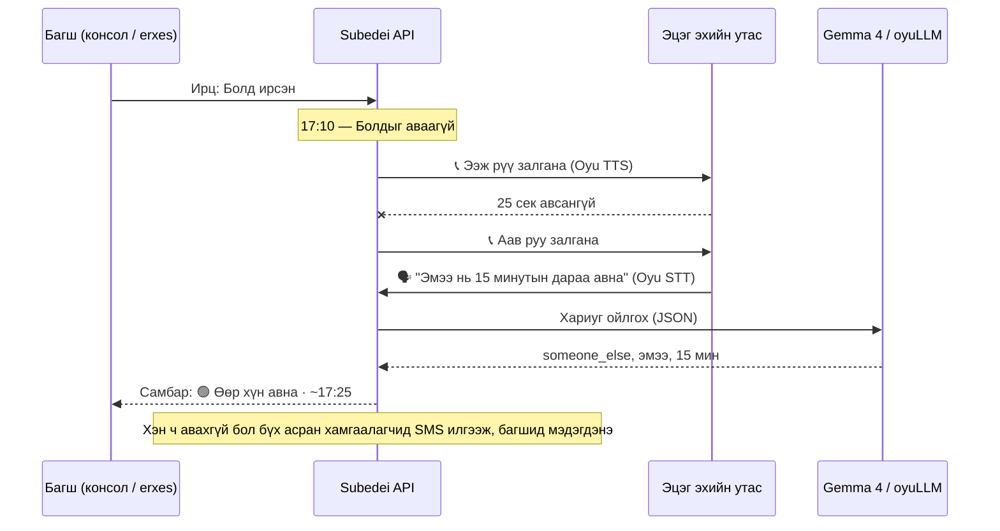

# Сүбэдэй — Багшийн автомат туслах

**erxes-д зориулсан нээлттэй эхийн EdTech plugin.** Багшийн өмнөөс эцэг эх рүү монголоор залгаж, ирц бүртгэхэд тусалж, хоцорсон эцэг эхтэй холбогдож, SMS болон хурлын сануулга илгээдэг.

> Hacktoberfest Hack Day Ulaanbaatar × erxes Hub, 2026-10-24

## Асуудал

Бага ангийн багш өдөр бүр олон жижиг ажилд цаг алддаг: ирц бүртгэх, хүүхдээ цагтаа аваагүй эцэг эх рүү нэг нэгээр залгах, утсаа авахгүй бол дараагийн хүн рүү залгах, хурал сануулах, олон эцэг эхэд нэг мэдээллийг дамжуулах. Хичээл тарсны дараа хүүхэд эцэг эхээ хүлээж удаан сууж, багш ажлаа хийж чадахгүй хоцордог.

> **Багш нар** хоцорсон эцэг эх рүү залгаж, ирц, хурлын мэдээллийг гараар дамжуулахад өдөр бүр цаг алддаг. **Бид** багшийн өмнөөс монголоор залгаж, хариуг нь AI-аар ойлгож, SMS илгээдэг туслах бүтээснээр **багшийн цагийг хэмнэж, хүүхдийн аюулгүй байдлыг сайжруулна.**

**Зорилтот хэрэглэгч:** бага ангийн болон цэцэрлэгийн багш, сургалтын менежер. Тэдний ангийн эцэг эх, асран хамгаалагчид.

## Үндсэн функцүүд

| Функц | Төлөв |
|---|---|
| **Ирц**: нэг товшилтоор ирсэн, тасалсан, хоцорсон, чөлөөтэй гэж тэмдэглэнэ. Бүртгээгүйг бүгдийг нь нэг дор "ирсэн" болгоно | ✅ |
| **Хоцорсон авалт**: хичээл тарснаас `PICKUP_GRACE_MIN` минутын дараа аваагүй хүүхдийн эцэг эх рүү **автоматаар залгана** | ✅ |
| **Дараалсан залгалт**: ээж утсаа авахгүй бол аав, дараа нь эмээ рүү залгана. Хэн ч авахгүй бол бүгдэд SMS илгээж, багшид мэдэгдэнэ | ✅ |
| **Монгол яриаг ойлгох**: "Эмээ нь 15 минутын дараа авна" гэсэн хариуг Gemma 4 `{someone_else, эмээ, 15 мин}` болгож, самбарыг шинэчилнэ | ✅ |
| **Тасалсан хүүхэд**: эцэг эх рүү залгаж шалтгааныг асуугаад ирцийг "чөлөөтэй" болгоно | ✅ |
| **Хурлын сануулга**: SMS-ийг тогтоосон цагт автоматаар илгээнэ. "1/2" эсвэл чөлөөт текстээр ирэх эсэхийг хүлээн авна. Хариу өгөөгүй эцэг эх рүү залгана | ✅ |
| **Олон эцэг эх рүү SMS**: бүгдэд, үндсэн эцэг эхэд, хүүхдээ аваагүйд, эсвэл тасалсан хүүхдийн эцэг эхэд нэг дор илгээнэ. Gemma 4 багшийн товч тэмдэглэлээс SMS найруулна | ✅ |
| **Эцэг эхийн SMS хариу**: "30 минутын дараа очно" гэсэн SMS-ийг ойлгож самбарыг шинэчилнэ | ✅ |
| **Өдрийн тайлан**: Gemma 4 өдрийн ирц, авалтын товч дүгнэлт бичнэ | ✅ |
| **Сурагч, эцэг эхээ өөрсдөө бүртгэх** (**Сурагчид** таб): сурагч болон асран хамгаалагчийг утасны дугаартай нь нэмэх, засах, хасах боломжтой. Залгах дарааллыг ↑↓ товчоор солино. Excel/Sheets-ээс 5 баганаа хуулж буулгаад олноор нь оруулна. Утасны дугаарыг шалгаж, `+976` болон хоосон зайг автоматаар цэвэрлэнэ. Ах дүү хүүхдийн эцэг эхийг нэг хүн гэж танина | ✅ |
| **erxes**: gateway-д plugin болж бүртгэгдэнэ, erxes дотор хуудастай. Эцэг эхийг erxes Contacts руу синк хийж, дуудлага бүрийг харилцагчийн timeline-д тэмдэглэнэ | ✅ build хийгдсэн, жинхэнэ erxes дээр туршаагүй |

## Яаж ажилладаг вэ



**AI-ийн найдвартай байдал:** Gemma-гийн гаргасан JSON-ийг zod-оор шалгана. Дүрмийн задлагч тодорхой хэллэг ("эмээ нь авна", "чадахгүй") илрүүлээд Gemma-тай зөрвөл дүрмийнхийг авна. Model ажиллахгүй бол систем дүрмийн задлагчаар үргэлжлэн ажиллана. Эцсийн шийдвэрийг (хүүхдийг өгөх эсэх) үргэлж багш гаргана.

## Технологи

| Хэсэг | Технологи |
|---|---|
| API | Node.js 22+, Express 5, Apollo Federation subgraph, Mongoose (MongoDB), zod |
| Багшийн консол, утасны симулятор | HTML, CSS, JavaScript (build шаардлагагүй), Server-Sent Events |
| erxes UI | React 18 Module Federation remote (Rspack), `@erxes/ui`, `@erxes/ui-modules`, Tailwind |
| AI | **Gemma 4** (Ollama, эсвэл DigitalOcean GPU Droplet дээрх vLLM/Ollama) эсвэл монгол хэлний **oyuLLM**. Хоёулаа OpenAI-compatible тул зөвхөн `.env`-ээр сольдог |
| Яриа | **Oyu**: tsuurAI TTS (`/v1/audio/speech`, WAV) ба Anir STT (`/v1/audio/transcriptions`). Түлхүүргүй үед browser-ийн Web Speech API ажиллана |
| SMS | HTTP gateway adapter, нөөц нь симулятор |
| erxes холболт | Redis service discovery, gateway subgraph, core-api tRPC (`customers.*`, `internalNotes.add`) |

## Суулгах, ажиллуулах

Шаардлага: **Node.js ≥ 22.12**, **MongoDB** (эсвэл Docker), AI ашиглах бол **Ollama**.

```bash
git clone https://github.com/ariunbold-bo/subedei.git
cd subedei
npm install -w subedei_api        # зөвхөн API + консол (хурдан)
cp .env.example .env
```

**1. MongoDB**: аль нэгийг сонгоно:

```bash
docker run -d --name subedei-mongo -p 27017:27017 mongo:7
```

эсвэл `.env` дотор `MONGO_MEMORY=true` гэж тохируулна (анх удаа mongod татна).

**2. Oyu яриа**: https://oyu.so/account/apikeys хуудаснаас түлхүүр аваад `.env` файлд `OYU_API_KEY=...` гэж бичнэ. Ингэснээр сургуулийн дуудлага монгол хоолойгоор ярьж, эцэг эхийн дуут хариуг Anir текст болгоно.

**3. AI model** (заавал биш, байхгүй бол дүрмийн задлагч ажиллана). Аль нэгийг сонгоно:

```bash
ollama pull gemma4
```

эсвэл `.env` дотор oyuLLM-ийг тохируулна. Энэ нь Oyu-ийн нөгөө түлхүүрээр ажилладаг, юу ч татах шаардлагагүй:

```
LLM_BASE_URL=https://api.oyu.so/v1
LLM_MODEL=oyuLLM
LLM_API_KEY=<oyu түлхүүр>
```

**4. Ажиллуулах:**

```bash
npm run dev
```

| Хаяг | Юу вэ |
|---|---|
| http://localhost:3399/ | Багшийн консол |
| http://localhost:3399/phone.html | Эцэг эхийн утасны симулятор (өөр таб эсвэл утсан дээр нээнэ) |
| http://localhost:3399/graphql | erxes subgraph |

Анх асаахад demo анги (2б, 8 сурагч, эцэг эхчүүд, эцэг эхийн хурал) автоматаар үүснэ. `npm run seed` эсвэл консолын **Тохиргоо → Demo ангийг дахин үүсгэх** нь demo өгөгдлийг сэргээнэ.

Өөрсдийн ангиа оруулах бол **Сурагчид → Demo-г устгаад өөрсдийн ангиа эхлүүлэх** товчийг дарна. Ангийн тохиргоо хэвээр үлдэнэ. Дараа нь сурагчаа нэг нэгээр нь нэмэх, эсвэл Excel-ээс мөр бүрт `Сурагчийн нэр · Овог · Хэн · Асран хамгаалагчийн нэр · Утас` гэсэн 5 баганаа хуулж буулгана.

Docker-оор бүгдийг нь асаах бол: `docker compose up --build`.

### Demo хийх дараалал (3 минут)

1. Консолыг дэлгэцэн дээр, `phone.html`-г утсан дээр эсвэл хажуугийн цонхонд нээнэ. Утсан дээр **"Болд · ээж"**-ийг сонгоод **Утсыг идэвхжүүлэх** товчийг дарна.
2. Консолд **⏰ Хоцорсон авалтыг одоо шалгах** товчийг дарна. Утас дуугарна.
3. Хариулаад 🎤 товчоор "Эмээ нь 15 минутын дараа авна" гэж хэлнэ (эсвэл хурдан хариултын товч дарна).
4. Консол дээр Болдын мөр **🟢 Өөр хүн авна · ~17:25** болж шинэчлэгдэнэ. **Дуудлага** таб дээр transcript болон Gemma-гийн дүгнэлт харагдана.
5. Сарнайн дуудлагыг авалгүй орхино. 25 секундийн дараа аав руу залгаж, хэн ч авахгүй бол **SMS** очно (утасны симулятор дээр харагдана).
6. **SMS** таб дээр "Маргааш спорт хувцастай" гэж бичээд **✨ AI-аар найруулах** дарж, **Илгээх** товчоор олон эцэг эх рүү илгээнэ.
7. **Хурал** таб дээр хурал үүсгэнэ. Утсан дээрээс "1" гэж хариулахад ирцийн тоо шинэчлэгдэнэ.

> 🎤 Утсан дээр микрофон ажиллахад HTTPS хэрэгтэй (`localhost` дээр шаардлагагүй). Утсаар нээх бол `cloudflared tunnel --url http://localhost:3399` гэх мэт tunnel ашиглаарай.

## erxes-тэй холбогдох

Subedei нь **албан ёсны `@erxes/create-plugin` (Express backend) бүтцээр** хийгдсэн бие даасан erxes plugin:

1. **Gateway бүртгэл**: `ERXES_ENABLED=true` үед API нь erxes-ийн Redis-д `erxes-service-subedei` болон `erxesservice:config:subedei` түлхүүрүүдийг бичнэ (`api/src/gateway.ts`, `joinErxesGateway`-тэй адил). Gateway subgraph-ыг supergraph-д нийлүүлнэ: `subedeiToday`, `subedeiCalls`, `subedeiMarkAttendance`, `subedeiMarkPickedUp`, `subedeiCallGuardians`, `subedeiCheckLatePickups`, `subedeiSendSms`.
2. **erxes дотор UI**: `ui/` бол core-ui-ийн ачаалдаг Module Federation remote. `/subedei` (Өнөөдөр), `/subedei/calls`, `/subedei/settings` хуудсууд erxes-ийн дизайн системээр (`erxes-ui`) хийгдсэн.
3. **Contacts синк**: эцэг эх бүр erxes core-д **харилцагч (customer)** болж бүртгэгдэнэ. Эхлээд `customers.findOne`-оор утасны дугаараар хайж, олдохгүй бол `customers.createCustomer`-оор үүсгэнэ. Холболт core-api-ийн tRPC-ээр явна (`x-trpc-context` header, Redis-ээс `erxes-service-core` хаяг авна). Консолын **Тохиргоо → erxes синк** товч.
4. **Timeline тэмдэглэл**: `ERXES_USER_ID` тохируулсан үед дуудлага, SMS бүр тухайн харилцагчийн timeline-д `internalNotes.add`-аар бичигдэнэ.
5. **Эрх**: erxes горимд GraphQL нь gateway-ээс ирсэн нэвтэрсэн хэрэглэгчийг шаардана.

erxes дээр ажиллуулах:

```bash
# erxes checkout-ийн .env:  ENABLED_PLUGINS=...,subedei   (gateway, core-api-г дахин асаах)
# энэ repo-ийн .env:         ERXES_ENABLED=true, REDIS_HOST=<erxes redis>
npm install
npm run dev:api
npm run dev:ui     # http://localhost:3099/remoteEntry.js
```

Дараа нь `http://localhost:3001/subedei`-г нээнэ. Нарийвчилсан тайлбар: [docs/erxes-integration.md](docs/erxes-integration.md).

## Тохиргоо

Бүх тохиргоо `.env` файлд: [.env.example](.env.example).

| Хувьсагч | Утга |
|---|---|
| `LLM_BASE_URL`, `LLM_MODEL`, `LLM_API_KEY` | AI endpoint: Gemma 4 (default `http://localhost:11434/v1`, `gemma4`) эсвэл oyuLLM (`https://api.oyu.so/v1`, `oyuLLM`) |
| `OYU_API_KEY`, `OYU_VOICE` | Oyu яриа: tsuurAI TTS (`female` / `mbspeech`), Anir STT. [`api/src/services/speech.ts`](api/src/services/speech.ts) |
| `SMS_HTTP_URL`, `SMS_HTTP_TOKEN` | SMS gateway (`{to, text, from}` JSON). Хариу SMS-ийн webhook: `POST /api/sms/inbound {from, text}` |
| `RING_TIMEOUT_SEC`, `PICKUP_GRACE_MIN`, `AUTO_PICKUP_CALLS` | Залгалтын дүрэм |
| `CALL_PROVIDER` | `simulator` = browser утас (demo), `auto` = Twilio бүрэн тохируулсан бол жинхэнэ утас, үгүй бол симулятор |
| `TWILIO_ACCOUNT_SID`, `TWILIO_API_KEY`, `TWILIO_API_SECRET`, `TWILIO_PHONE_NUMBER`, `TWILIO_TRIAL`, `PUBLIC_URL` | Жинхэнэ утас (Twilio). Доорх хэсгийг үзнэ үү |
| `ERXES_ENABLED`, `REDIS_*`, `ERXES_USER_ID` | erxes холболт |

### Жинхэнэ утас руу залгах (Twilio)

Код бэлэн ([`services/twilio.ts`](api/src/services/twilio.ts), [`twilio-routes.ts`](api/src/twilio-routes.ts)). Систем Twilio REST-ээр дугаар руу залгана. Эцэг эх утсаа авахад Twilio манай `/twilio/voice` webhook-ээс TwiML авч, Oyu-ийн монгол дууг `<Play>`-ээр тоглуулна. Хариуг upgrade хийсэн аккаунт дээр `<Record>` + Oyu STT-ээр, trial аккаунт дээр товчлуураар (`<Gather>`) авна. Утсаа авахгүй, завгүй эсвэл алдаа гарвал `/twilio/status`-аар дараагийн асран хамгаалагч руу шилжинэ. Webhook бүр дуудлагын HMAC token-оор хамгаалагдсан.

Шаардлага:
- **Upgrade хийсэн Twilio аккаунт** болон Twilio-гийн дуудлага хийх дугаар (`TWILIO_PHONE_NUMBER`), Voice Geo Permissions дээр Mongolia идэвхтэй байх. Мөн `.env`-д `TWILIO_TRIAL=false`.
- `PUBLIC_URL`: Twilio-д хүрэх энэ серверийн нийтийн https хаяг. Түүгээр зөвхөн `/twilio/*` болон `/media/audio/*` зам нээлттэй, консол болон бичлэгүүд гадагш гарахгүй.

**Trial аккаунтын хязгаарлалт (туршиж батлагдсан):** trial-ийн гарах дуудлага зөвхөн Twilio-гийн өөрийн загвар холбоосыг ажиллуулдаг ([Twilio trial](https://www.twilio.com/docs/usage/trials/try-out-voice)). Манай дуудлага утсанд хүрсэн ч Twilio манай webhook руу хандаагүй. Тиймээс demo-г `CALL_PROVIDER=simulator`-оор browser утсаар үзүүлдэг.

## Шалгах

```bash
npm test          # 44 тест: монгол хариу задлагч, AI хамгаалалт, залгалтын урсгал, Twilio webhook, сурагч/эцэг эхийн бүртгэл (MongoDB хэрэгтэй)
npm run check     # API + erxes UI type-check
npm run build     # API dist + ui/dist/remoteEntry.js
```

MongoDB хэрэгтэй тестүүд нь `TEST_MONGO_URL` өгвөл тэр MongoDB-г ашиглана (тест файл бүр өөрийн `_flow`, `_roster` database-тэй). Өгөхгүй бол in-memory MongoDB асаана.

## Одоогийн хязгаарлалт ба цаашдын төлөвлөгөө

**Одоогийн байдал (шударгаар):**
- **Утасны дуудлага**: demo нь browser утасны симулятороор явна. Twilio-гоор жинхэнэ утас руу залгах код бэлэн. Trial аккаунтаар туршихад дуудлага утсанд хүрсэн ч trial дүрмийн улмаас Twilio манай webhook-ийг ажиллуулаагүй. Upgrade хийсэн аккаунт хэрэгтэй (дээрх "Жинхэнэ утас руу залгах" хэсгийг үзнэ үү).
- **Oyu** TTS/STT-ийг жинхэнэ API дээр туршсан: TTS ойролцоогоор 1.7 секунд, STT ойролцоогоор 1 секунд. Синтетик дуун дээр STT "Болд" гэдгийг "бол", "эмээ нь" гэдгийг "энэ нь" гэж сонссон тохиолдол гарсан. Жинхэнэ хүний дуун дээр туршиж шалгах хэрэгтэй.
- **AI**: урсгалыг `gemma3:1b` (локал) болон `oyuLLM` дээр туршсан. `gemma4` model локалд татагдаагүй байсан. Жижиг model тоо буруу тоолох зэрэг алдаа гаргадаг тул тодорхой тоо, хүний нэрийг дүрмийн задлагч давхар шалгана.
- **erxes**: plugin build хийгдэж, subgraph ажиллаж байна. Жинхэнэ erxes stack дээр gateway бүртгэл болон Contacts синкийг ментортой хамт шалгах шаардлагатай.
- Нэг сургууль, нэг ангид зориулсан. Standalone консолд нэвтрэлт байхгүй (зөвхөн дотоод сүлжээнд ажиллуулна). erxes горимд erxes-ийн нэвтрэлтийг ашиглана.

**Дараагийн алхам:** жинхэнэ утасны холболт (SIP), олон анги ба багшийн эрх, эцэг эхийн Client Portal, хүүхэд авах хүмүүсийн зөвшөөрөлтэй жагсаалт, яаралтай зарлал (хүйтэн, хорио цээр), долоо хоногийн тайлан, хоцролтын статистик.

## Бүтэц

```
api/src/
  main.ts              Express: REST /api, GraphQL subgraph, web консол, scheduler
  routes.ts            Консол ба утасны симуляторын REST API
  graphql/schema.ts    erxes supergraph-д нийлэх subgraph (Subedei* төрлүүд)
  models.ts            MongoDB: Classroom, Student, Guardian, DayRecord, Call, CallFlow, SmsMessage, Meeting
  services/calls.ts    Залгалтын урсгал: ring → answer → reply → intent → next / SMS
  services/intent.ts   Gemma 4 / oyuLLM + монгол дүрмийн задлагч
  services/speech.ts   Oyu tsuurAI TTS, Anir STT
  services/sms.ts      SMS gateway adapter, Latin галиг
  services/erxes.ts    erxes core tRPC: Contacts, timeline тэмдэглэл
  services/scheduler.ts Автомат залгалт, timeout, хурлын сануулга
web/                   Багшийн консол (index.html), утасны симулятор (phone.html)
ui/                    erxes Module Federation remote
```

## Лиценз

[MIT](LICENSE)
